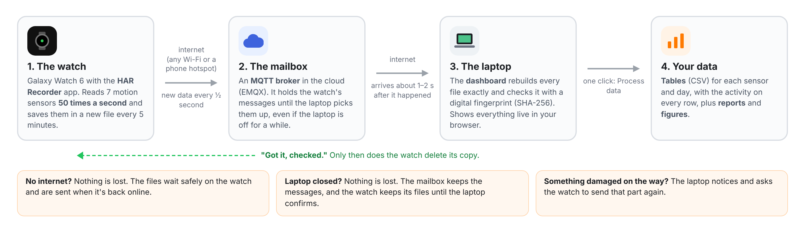

# HAR Recorder

**Record how people move, with a smartwatch, and get the data on your laptop without losing any of it.**

HAR stands for *Human Activity Recognition*: teaching a computer to recognize what a person is doing (walking, sitting, climbing stairs…) from the motion sensors in a watch. To do that, you first need good data, with each moment **labeled** with what the person was doing. This project collects that data.

You wear a Samsung Galaxy Watch 6. It records its motion sensors all day. You tap a button on the watch to say what you are doing. The data reaches your laptop about 1–2 seconds later, over any internet connection. On the laptop, one click turns it into tables you can open in Excel or Python.

<p align="center"></p>

---

## Where to start

| I want to… | Read |
|---|---|
| Set everything up for the first time | **[docs/SETUP.md](docs/SETUP.md)**, about 45 minutes, done once |
| Record data, label activities, use the dashboard | **[docs/USER_GUIDE.md](docs/USER_GUIDE.md)** |
| Understand what the project does and how | This page |

---

## What it can do

- **Records all day.** The app keeps running when the screen is off, after the watch restarts, and while you use other apps.
- **Labels activities.** Tap *Start activity* → *Walking* on the watch. Every reading from then until you tap *Stop* is marked "walking".
- **Live on your laptop.** A dashboard in your web browser shows the motion as it happens, which activity is running, the battery, and more.
- **Works from anywhere.** The watch and the laptop do **not** need to be on the same Wi-Fi. Any internet works, including a phone hotspot.
- **Loses nothing.** No internet, laptop closed, watch restarted: the data waits on the watch, and the watch only deletes a file after the laptop has confirmed it arrived complete.
- **Explains every gap.** If data is missing, the report says why: *stopped by user*, *battery ran out*, *watch restarted*, and so on.
- **One-click results.** Tables (CSV) for every sensor and day, a report for each day, and figures.

---

## The sensors

The watch records 7 sensors. Most of them measure **50 times per second** (50 Hz). Each motion sensor gives three numbers, **x, y and z**, one for each direction.

| Sensor | What it measures | How often | Unit | Useful for |
|---|---|---|---|---|
| **Accelerometer** | How the watch speeds up or slows down, **including gravity** | 50 per second | m/s² | The main sensor for activities: steps, arm swings, shakes |
| **Gyroscope** | How fast the watch **turns** | 50 per second | rad/s | Wrist rotation: eating, brushing teeth, typing |
| **Magnetometer** | The Earth's magnetic field, like a compass | 50 per second | µT | Which way the person faces; strong changes near metal |
| **Gravity** | Which way is "down" for the watch (worked out by the watch) | 50 per second | m/s² | How the arm is held (hanging, raised, flat on a table) |
| **Linear acceleration** | Accelerometer **minus gravity**: only the movement | 50 per second | m/s² | Movement without the effect of how the arm is held |
| **Barometer** | Air pressure | 5 per second | hPa | Going up or down: stairs, elevators. 1 floor ≈ 0.4 hPa |
| **Off-body** | Whether the watch is **on the wrist** or taken off | When it changes | on / off | Finding times when the watch wasn't worn |

> [!NOTE]
> The watch actually measures about **49.8** times per second, not exactly 50. That's normal for this watch. Every reading has its exact time, to the nanosecond, so it doesn't matter.

---

## How it works, in simple words

1. **The watch records.** The *HAR Recorder* app reads the sensors and writes every reading into a file on the watch. Every 5 minutes it starts a new file.
2. **The watch sends.** Every half second it sends the newest part of the file over the internet to a **broker**. A broker is like a **mailbox in the cloud**: the watch drops messages in, and the laptop picks them up. We use a free one called **EMQX**. The connection is encrypted.
3. **The laptop receives and checks.** The **dashboard** program on your laptop picks up the messages and rebuilds each file exactly. When a file is complete, it checks the file with a digital **fingerprint** (SHA-256). If even one byte were wrong, the fingerprint wouldn't match.
4. **The watch deletes its copy.** Only after the check passes does the laptop say "got it". Only then does the watch delete that file. If anything goes wrong on the way, the laptop asks for that part again.
5. **The watch keeps a diary.** Besides the sensor files, the watch writes a small diary: "recording started", "battery 54 %", "watch taken off", "activity *walking* started", and so on. The diary travels the same way. It is used to explain gaps and to label the data.
6. **One click makes tables.** *Process data* on the dashboard turns the files into one table per sensor per day, adds the activity to every row, and writes the reports.

---

## Tech stack

| Part | Built with |
|---|---|
| **Watch app** | Kotlin, Android / Wear OS 4 (Android 14), built in **Android Studio**. A *foreground service* keeps it recording with the screen off. |
| **Sending data** | **MQTT**, a small, reliable messaging method made for devices like watches and sensors. Library: Eclipse Paho. Encrypted with TLS. |
| **The mailbox (broker)** | **EMQX Cloud Serverless**: free up to 1 GB of data per month, no credit card |
| **Laptop programs** | **Python 3.9+** with paho-mqtt (receiving), Flask (dashboard), NumPy and pandas (tables), matplotlib (figures) |
| **Dashboard page** | Plain HTML, CSS and JavaScript in your browser. It only runs on your own laptop (`http://localhost:8765`). |
| **Installing the app** | **adb** (Android Debug Bridge, comes with Android Studio), over Wi-Fi |

---

## What's in this project

```
HAR-Recorder/
├── README.md               ← you are here
├── docs/
│   ├── SETUP.md            ← first-time setup, step by step
│   ├── USER_GUIDE.md       ← recording, labeling, dashboard, results
│   └── images/             ← the pictures in these guides
├── watch-app/              ← the watch app (open this folder in Android Studio)
└── laptop/                 ← the laptop programs
    ├── dashboard.py        ← START HERE: receives the data and shows the dashboard
    ├── dashboard.html      ← the dashboard page
    ├── live_receiver.py    ← the receiving part (the dashboard uses it)
    ├── process_data.py     ← "Process data": files → tables and reports
    ├── visualize_data.py   ← "Make figures": tables → pictures
    ├── pull_from_watch.py  ← backup: copy files straight from the watch with adb
    └── requirements.txt    ← the Python packages needed
```

Your recorded data is **not** in this project. It is saved on your laptop in `~/HAR_Recorder/data` (you can change this in the dashboard settings).

---

## Good to know

> [!IMPORTANT]
> **The broker password is private.** It is not stored in this project. Whoever sets up the broker shares it with you directly, never on GitHub.

- **Free limit:** the free EMQX plan allows **1 GB a month**. One watch sends roughly 10–20 MB per hour of recording, so 1 GB is about 50–100 hours. For a whole class, use a paid plan or a university server.
- **One dashboard per broker login.** If two laptops run the dashboard with the same login at the same time, they keep pushing each other off. Use one laptop to collect, or ask for separate logins.
- **The data is personal.** Motion data can reveal a lot about a person's day. Ask before recording someone, and store the data carefully.

---

## To-do

- [ ] A **double-click launcher** (`HAR Recorder.command` for Mac, `HAR Recorder.bat` for Windows), so the dashboard starts without typing commands
- [ ] An easier way to install the watch app (without Android Studio)
