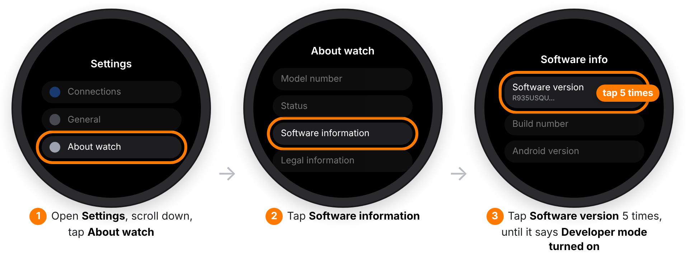
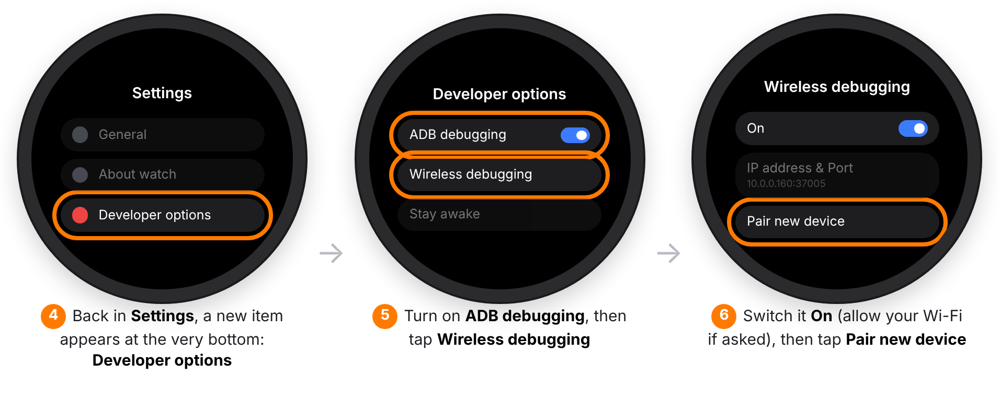
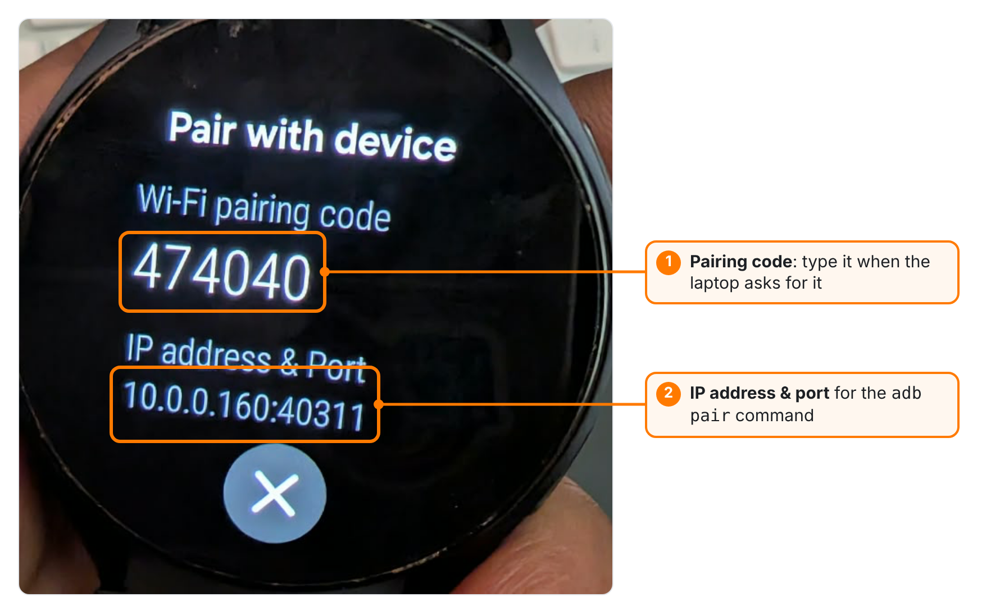
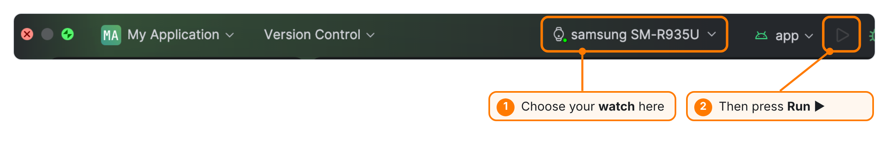
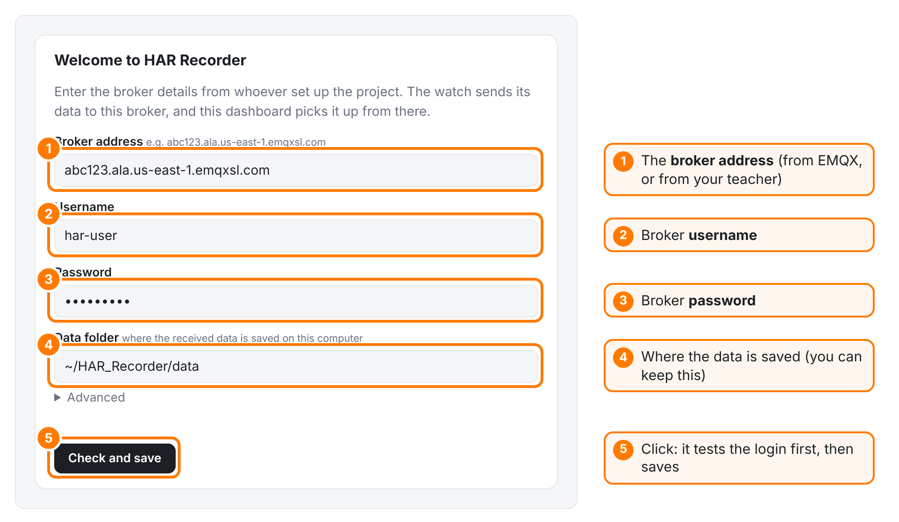

# First-time setup

This guide sets everything up from zero. You only do it **once** per watch and laptop. It takes about 45 minutes, mostly waiting for downloads.

**You need:**

- a **Samsung Galaxy Watch 6** (other Wear OS watches with the same sensors may also work)
- a **laptop**, Mac or Windows
- **Wi-Fi** that both the watch and the laptop can join. This is only needed for installing the app. Afterwards, any internet works.
- the **broker details**: an address, a username and a password. If someone already set up the broker for you (for example your teacher), ask them for these and skip Part 1.

**Overview**

| Part | What | Who |
|---|---|---|
| [1](#part-1--create-the-mailbox-broker) | Create the mailbox (broker) | **One person** for the whole group |
| [2](#part-2--prepare-the-laptop) | Prepare the laptop | Everyone |
| [3](#part-3--put-the-app-on-the-watch) | Put the app on the watch | Once per watch |
| [4](#part-4--start-the-dashboard) | Start the dashboard | Everyone |
| [5](#part-5--check-that-everything-works) | Check that everything works | Everyone |

> [!TIP]
> Words in **bold** are things you will see on the screen. `Grey boxes` are things to type exactly.

---

## Part 1 – Create the mailbox (broker)

*Skip this part if someone gave you a broker address, username and password.*

The **broker** is a mailbox on the internet. The watch drops its data in, and the laptop picks it up. We use **EMQX Cloud**, which is free.

1. Go to **[emqx.com](https://www.emqx.com/en/cloud)** and create a free account.
2. In the EMQX Cloud console, click **New Deployment**, choose **Serverless** (the free one), pick the region closest to you, and click **Deploy**. Wait about a minute until it says **Running**.
3. Open the deployment. Go to **Access Control → Authentication** and click **Add**. Choose a **username** (for example `har-user`) and a strong **password**. Write both down.
4. On the deployment's **Overview** page, copy the **Address**. It looks like `abc123.ala.us-east-1.emqxsl.com`. The port for **MQTT over TLS** is `8883`.

You now have the 3 broker details: **address**, **username**, **password**. Share them privately (never on GitHub).

> [!NOTE]
> EMQX sometimes renames buttons. If you can't find one, look for anything named *deployment*, *authentication* or *connection address*.

---

## Part 2 – Prepare the laptop

### 2.1 Install Python

1. Go to **[python.org/downloads](https://www.python.org/downloads/)** and install the newest **Python 3**.
   - **Windows:** on the first screen of the installer, tick **Add python.exe to PATH**.
   - **Mac:** when it's done, open **Applications → Python 3.x** and double-click **Install Certificates.command**. Without this, the secure connection to the broker fails.

### 2.2 Install Android Studio

Android Studio is the program that puts the app on the watch.

1. Download it from **[developer.android.com/studio](https://developer.android.com/studio)** and install it with the normal settings.
2. Open it once and let it finish downloading its parts (this takes a while).

### 2.3 Download this project

1. On this project's GitHub page, click the green **Code** button → **Download ZIP**.
2. Unzip it. Remember where the folder is. In this guide we call it `HAR-Recorder`.

### 2.4 Make the `adb` command work

`adb` is a small tool that comes with Android Studio. It talks to the watch. Open a terminal:

- **Mac:** open the **Terminal** app.
- **Windows:** open the Start menu and type **cmd**, then open **Command Prompt**.

<details open>
<summary><b>Mac</b></summary>

Type this and press Enter, then **close the Terminal and open a new one**:

```bash
echo 'export PATH="$PATH:$HOME/Library/Android/sdk/platform-tools"' >> ~/.zshrc
```
</details>

<details>
<summary><b>Windows</b></summary>

Every time you need `adb`, first go to its folder:

```bat
cd %LOCALAPPDATA%\Android\Sdk\platform-tools
```
</details>

Check that it works:

```bash
adb version
```

You should see `Android Debug Bridge version …`. If you see *command not found*, see [Problems](#if-something-goes-wrong).

---

## Part 3 – Put the app on the watch

Do this **once per watch**. The watch and the laptop must be on the **same Wi-Fi** for this part.

### 3.1 Turn on Developer mode on the watch

<p align="center"></p>

### 3.2 Turn on Wireless debugging

<p align="center"></p>

> [!NOTE]
> These pictures are simplified drawings. The menus on your watch may look a little different or use slightly different names, but the steps are the same.

### 3.3 Pair the laptop with the watch

After you tap **Pair new device**, the watch shows a **pairing code** and an **IP address & port**:

<p align="center"></p>

In the terminal, type `adb pair` followed by **the IP address & port from that screen** (yours will be different):

```bash
adb pair 10.0.0.160:40311
```

When it asks for the **pairing code**, type the 6 digits from the watch. It should say **Successfully paired**.

Now go back one screen on the watch, to the main **Wireless debugging** screen. It shows another **IP address & port**. Note that **the port is different** from the pairing one. Connect to it:

```bash
adb connect 10.0.0.160:37005
adb devices
```

`adb devices` should list your watch with the word **device** after it. 🎉

### 3.4 Enter the broker details in the app

1. In Android Studio, click **File → Open** and choose the `watch-app` folder inside `HAR-Recorder`. Wait until the bottom bar stops showing progress (the first time can take several minutes). If a yellow bar says **Sync Now**, click it.
2. In the file list on the left, open **app → kotlin+java → com.example.myapplication.presentation → LiveConfig.kt**.
3. Fill in the 3 broker details between the quotes:

```kotlin
// your address, with ssl:// before it and :8883 after it
const val BROKER_URL = "ssl://abc123.ala.us-east-1.emqxsl.com:8883"
const val USERNAME = "har-user"
const val PASSWORD = "your-password"
```

> [!WARNING]
> Don't forget `ssl://` at the start and `:8883` at the end. Without them, the watch shows **REC · OFFLINE** and never connects.

### 3.5 Install the app

<p align="center"></p>

1. At the top of Android Studio, choose your **watch** in the device menu (it appears after the `adb connect` step).
2. Press the green **Run ▶** button. After a minute or two, **HAR Recorder** opens on the watch.

### 3.6 First start on the watch

1. If the watch asks to **allow notifications**, tap **Allow**. The notification is how Android lets the app keep running.
2. If you see **⚠ Allow background use** in yellow on the app's screen, tap it and choose **Allow**. Otherwise the watch may pause recording to save battery.
3. If the yellow warning **doesn't go away**, type these two lines in the terminal (the watch must still be connected with `adb`):

```bash
adb shell dumpsys deviceidle whitelist +com.example.myapplication
adb shell cmd appops set com.example.myapplication RUN_ANY_IN_BACKGROUND allow
```

That's it for the watch. **From now on, the watch does not need Android Studio, adb or the same Wi-Fi.**

---

## Part 4 – Start the dashboard

The **dashboard** is a program on your laptop. It receives the data and shows it in your web browser.

### 4.1 The first time

Open a terminal and go to the `laptop` folder of the project. Change the path to where your folder is:

<details open>
<summary><b>Mac</b></summary>

```bash
cd ~/Downloads/HAR-Recorder/laptop
python3 -m venv .venv
.venv/bin/python -m pip install -r requirements.txt
.venv/bin/python dashboard.py
```
</details>

<details>
<summary><b>Windows</b></summary>

```bat
cd %USERPROFILE%\Downloads\HAR-Recorder\laptop
py -3 -m venv .venv
.venv\Scripts\python -m pip install -r requirements.txt
.venv\Scripts\python dashboard.py
```
</details>

What these lines do:

- **Line 1** goes into the folder.
- **Line 2** makes a private Python space (`.venv`) just for this project, so nothing else on your laptop changes.
- **Line 3** downloads the packages it needs (about a minute).
- **Line 4** starts the dashboard.

Your browser opens **http://localhost:8765** by itself. Keep the terminal window open, because closing it stops the dashboard.

### 4.2 Fill in the setup form

The first time, the dashboard asks for the broker details:

<p align="center"></p>

Click **Check and save**. The dashboard tests the login first. If something is wrong, it tells you what in plain words, for example **Wrong username or password.**

### 4.3 Every next time

Only the `cd` line and the last line are needed:

```bash
cd ~/Downloads/HAR-Recorder/laptop        # Windows: cd %USERPROFILE%\Downloads\HAR-Recorder\laptop
.venv/bin/python dashboard.py             # Windows: .venv\Scripts\python dashboard.py
```

> [!NOTE]
> A double-click launcher that replaces these commands is on the to-do list.

---

## Part 5 – Check that everything works

1. On the watch, open **HAR Recorder** and tap **Start recording**. Within a few seconds it should say **REC · LIVE**.
2. On the dashboard, your watch appears with a green **LIVE** label, and the plots start moving when you move your arm.
3. Tap **Start activity** on the watch, pick **Walking**, walk for a minute, then stop it. The dashboard shows **NOW Walking** while you walk.

If all three work, you're done. Continue with the **[User guide](USER_GUIDE.md)**.

---

## If something goes wrong

| What you see | What it means | What to do |
|---|---|---|
| `adb: command not found` (Mac) or `'adb' is not recognized` (Windows) | The terminal can't find adb | Mac: do [step 2.4](#24-make-the-adb-command-work) again and **open a new Terminal**. Windows: run the `cd …platform-tools` line first. |
| `adb pair` says **failed** | Wrong port or code, or the code expired | Tap **Pair new device** again for a fresh code, and use the port from *that* screen. |
| The watch isn't in Android Studio's device menu | Not connected | Run `adb connect` again with the port from the main **Wireless debugging** screen. Check both are on the same Wi-Fi. |
| Android Studio shows red `eclipse` errors | Its parts aren't downloaded yet | Click **Sync Now** in the yellow bar (or **File → Sync Project with Gradle Files**). |
| Watch says **REC · OFFLINE** | The watch can't reach the broker | Check the watch has internet. Check `LiveConfig.kt`: `ssl://` at the start, `:8883` at the end, correct username and password. Install again with **Run ▶**. |
| **⚠ Allow background use** won't go away | The watch's battery saver still limits the app | Run the two `adb shell` lines in [step 3.6](#36-first-start-on-the-watch). |
| Dashboard: **Wrong username or password.** | The login doesn't match the broker | Check for typos and spaces. It must be exactly what was set in EMQX (Part 1, step 3). |
| Dashboard: **The encrypted connection failed…** (Mac) | Python is missing its certificates | Open **Applications → Python 3.x → Install Certificates.command**, then try again. |
| Dashboard: **Can't reach the broker…** | The network blocks the broker | Some campus networks block port 8883. Try another Wi-Fi or a phone hotspot. |
| The dashboard shows the watch as **OFFLINE** although the watch says LIVE | Two dashboards are using the same login | Close the other dashboard (on this or another laptop). Only one may run at a time per login. |
| A gap in the data says **app restarted (reinstall or crash)** | Pressing **Run ▶** in Android Studio restarts the app | Normal while installing. Nothing to do. |
