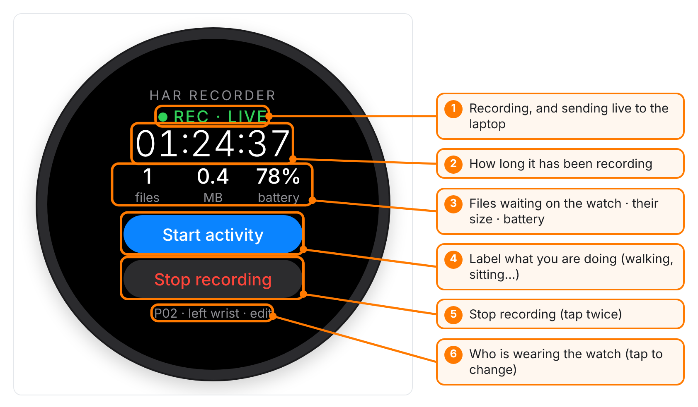
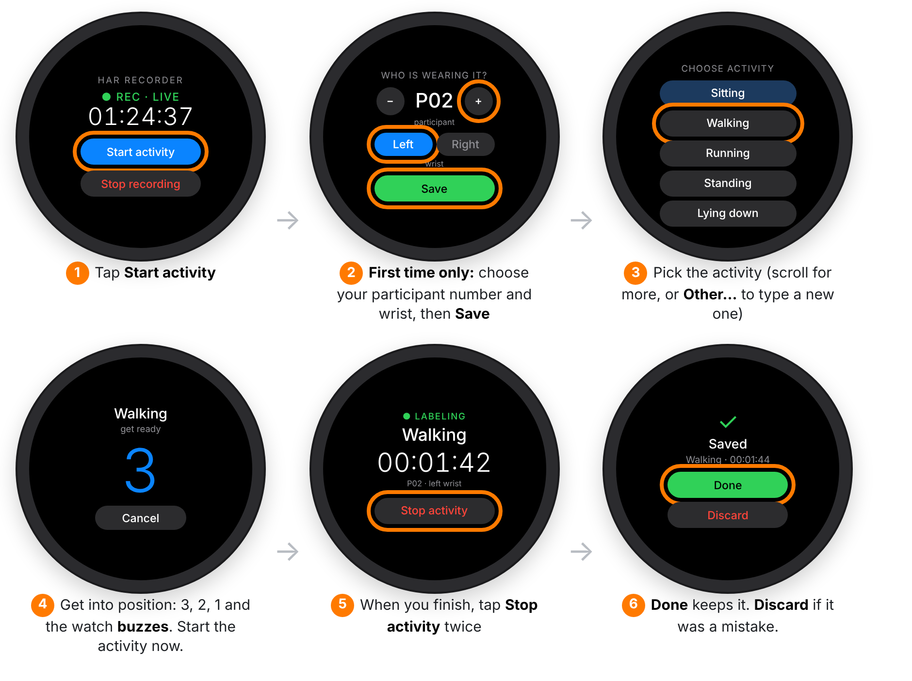
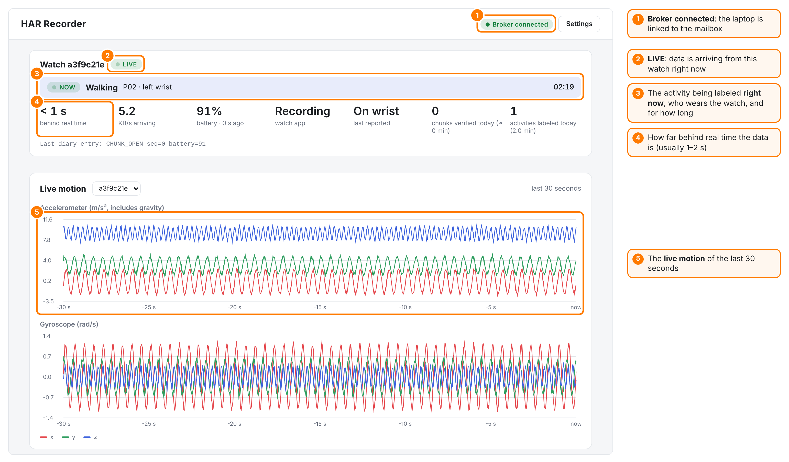
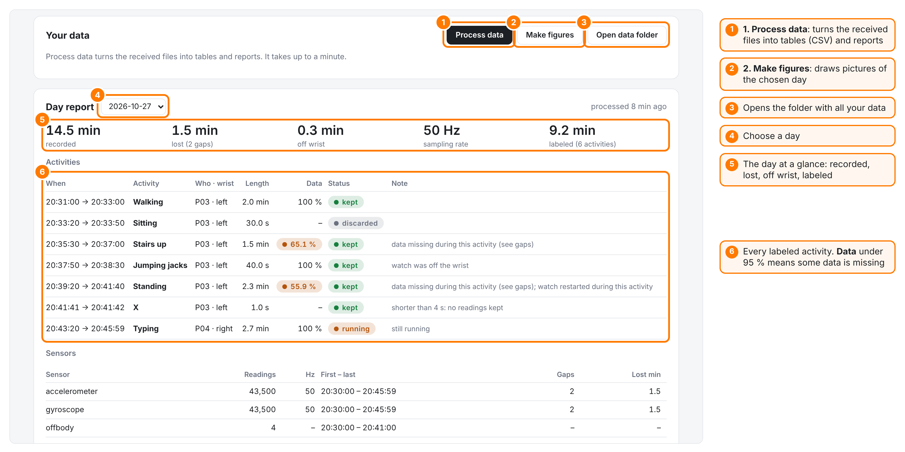
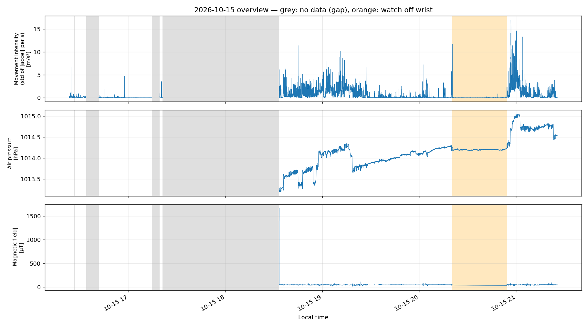
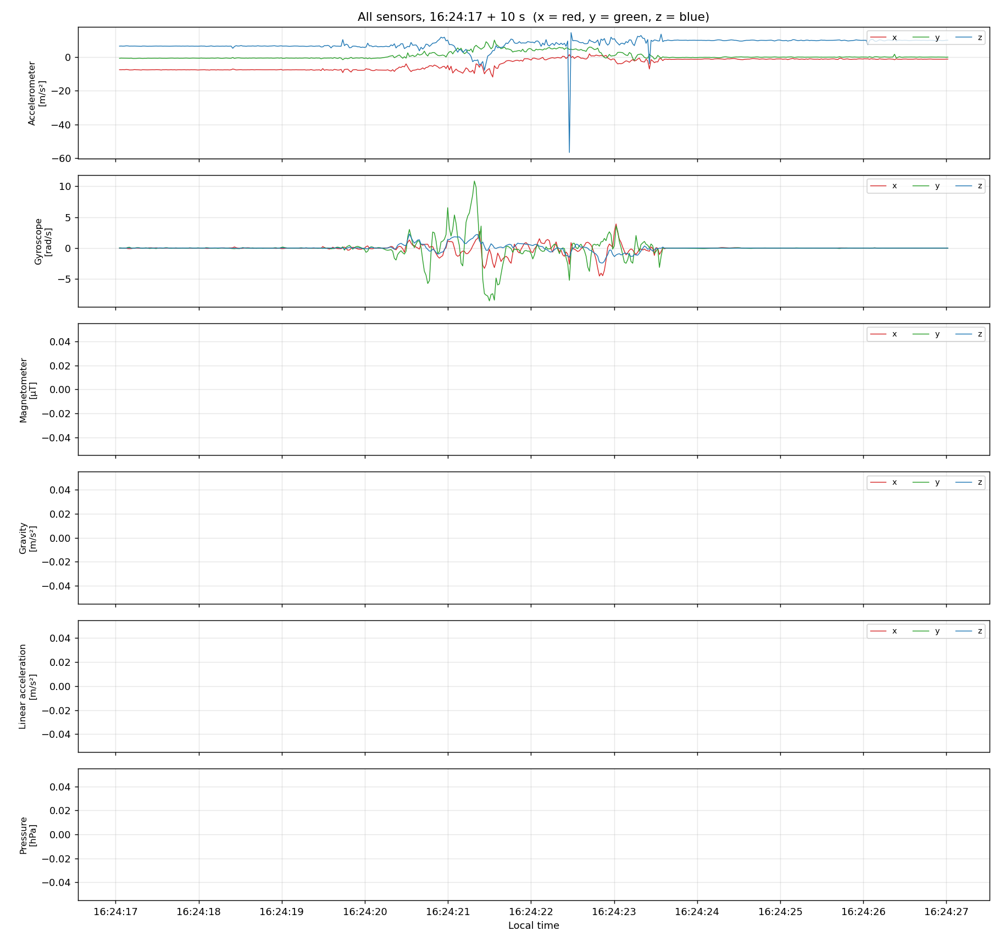
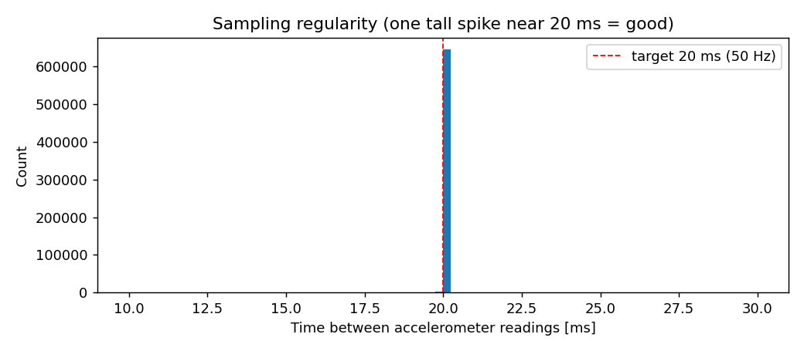

# User guide

How to record, label activities, watch the data arrive, and get your results. If you haven't set things up yet, start with **[SETUP.md](SETUP.md)**.

**Contents**
1. [The watch app](#1-the-watch-app)
2. [Labeling an activity](#2-labeling-an-activity)
3. [The dashboard](#3-the-dashboard)
4. [Getting your results](#4-getting-your-results)
5. [Your data files](#5-your-data-files)
6. [Using the data in Python](#6-using-the-data-in-python)
7. [Tips for good data](#7-tips-for-good-data)

---

## 1. The watch app

Open **HAR Recorder** on the watch.

<p align="center"></p>

**The status line:**

| It says | Meaning |
|---|---|
| **REC · LIVE** (green) | Recording, and the data is reaching the laptop right now |
| **REC · OFFLINE** | Recording, but no internet at the moment. That's fine: the data waits on the watch and is sent later. |
| **STOPPED** (grey) | Not recording. Tap **Start recording**. |

**Good to know:**

- You can **leave the app**, turn the screen off, or use other apps. Recording continues in the background, and a small notification shows it's running.
- If the watch **restarts** (or the battery dies and you charge it), recording **starts again by itself**.
- **Stop recording** needs **two taps**, so you can't stop it by accident.
- **files / MB** count the files still waiting on the watch. With internet, this stays at 0 or 1, because files are deleted once the laptop has them. Without internet, it grows, and that's normal.

---

## 2. Labeling an activity

Labeling tells the data **what you were doing**. Recording never stops for a label: a label just marks "from here to here, this person was walking".

<p align="center"></p>

1. Tap **Start activity**. If recording was off, this also turns it on.
2. **First time only:** choose the **participant number** (P01, P02…) with − and +, and the **wrist** the watch is on. Tap **Save**. Change it later by tapping the grey line on the home screen.
3. **Pick the activity.** The ones you used recently are at the top, in blue. Scroll with your finger or by turning the bezel. **Other…** lets you type or say a new name.
4. A **3-2-1 countdown** gives you time to get into position. When the watch **buzzes**, start the activity.
5. When you're finished, tap **Stop activity** twice.
6. **Done** keeps the label. **Discard** marks it as a mistake: the sensor data is kept, but it isn't labeled.

> [!TIP]
> - If you close the app during an activity, the label keeps running. Open the app again to stop it.
> - The first and last **2 seconds** of each activity are left out automatically when the data is processed. That's when you were tapping the watch.

---

## 3. The dashboard

Start the dashboard on your laptop ([Part 4 of the setup](SETUP.md#part-4--start-the-dashboard)). It opens in your browser at **http://localhost:8765**.

### Live view

<p align="center"></p>

Each watch has its own card:

| You see | Meaning |
|---|---|
| **LIVE** / **OFFLINE · last data … ago** | Whether data is arriving from this watch right now |
| **NOW Walking · P02 · left wrist · 02:19** | The activity being labeled, who wears the watch, and for how long. It says **LAST KNOWN** when the watch is offline. |
| **behind real time** | How old the newest data is, usually 1–2 seconds |
| **battery** | The watch's battery, as last reported |
| **On wrist / Off wrist** | Whether the watch is being worn |
| **chunks verified today** | How many 5-minute files arrived complete and checked today |
| **activities labeled today** | How many activities were labeled today, and their total time |

The two plots show the **last 30 seconds** of the accelerometer and gyroscope. Red, green and blue are the x, y and z directions. Move your arm and watch the lines move.

### Settings

The **Settings** button (top right) changes the broker details or the folder where data is saved.

---

## 4. Getting your results

<p align="center"></p>

1. Click **Process data**. It turns everything received so far into tables and reports, which takes up to a minute. You can do this as often as you like: it always starts fresh from the received files.
2. Pick a **day**, then click **Make figures** to draw pictures of that day.
3. **Open data folder** opens the folder with all the files.

### The day report

- **The numbers on top:** time recorded, time lost (data that is really missing, *not* times you stopped on purpose), time off the wrist, measuring speed, and time labeled.
- **Activities:** every label with its time, who, length and status (**kept**, **discarded** or **running**). The **Data** column shows how complete the data is during that activity. **Under 95 %** (orange) means part of it is missing, and the **Note** says why.
- **Sensors:** how many readings each sensor has.
- **Gaps:** every time the data stops, with the **reason** from the watch's diary:

| Reason | Meaning |
|---|---|
| **stopped by user** (grey) | Someone tapped Stop. Planned, so it doesn't count as lost. |
| **battery ran out** | The watch switched off |
| **watch rebooted** | The watch restarted |
| **app restarted (reinstall or crash)** | Usually from installing a new version |
| **stopped by the system** | The watch closed the app, usually battery saving (see [setup step 3.6](SETUP.md#36-first-start-on-the-watch)) |
| **unknown** (red) | The diary doesn't explain it. Please report it. |

### The figures

**Whole day.** Grey areas mean no data, orange areas mean the watch was off the wrist:

<p align="center"></p>

- **Movement intensity:** how much the wrist moves, second by second. Flat near 0 = still. Tall = active.
- **Air pressure:** steps up and down are changes in height, like stairs, an elevator or a hill. Slow drifts are the weather.
- **Magnetic field:** steady most of the time. Jumps happen near metal or electronics.

**A few seconds of every sensor**, to see what the raw signals look like:

<p align="center"></p>

**Sampling regularity.** One tall, narrow spike near 20 ms (50 times a second) means the watch measured evenly:

<p align="center"></p>

`Make figures` also writes a short **sanity check** (`reports/<day>_sanity_checks.txt`). It confirms the numbers make physical sense. For example, a still watch should measure gravity, about 9.8 m/s².

---

## 5. Your data files

Everything is saved on your laptop in **`~/HAR_Recorder/data`**. On a Mac, `~` means your home folder. On Windows, it's `C:\Users\<you>`.

```
data/
├── processed/2026-10-27/      ← tables, one folder per day
│   ├── accelerometer.csv
│   ├── gyroscope.csv
│   ├── magnetometer.csv
│   ├── gravity.csv
│   ├── linear_acceleration.csv
│   ├── barometer.csv
│   └── offbody.csv
├── reports/
│   ├── labels.csv             ← one row per labeled activity
│   ├── daily_summary.csv      ← readings and gaps per sensor and day
│   ├── gaps.csv               ← every gap, with its reason
│   ├── off_wrist.csv          ← when the watch was taken off
│   └── problems.txt           ← anything unusual found while processing
├── figures/                   ← the pictures from "Make figures"
├── raw/                       ← the original files from the watch (don't edit)
└── events/                    ← the watch's diary (don't edit)
```

> [!IMPORTANT]
> **Keep `raw/` and `events/`.** They are the original data. Everything else can be made again from them with **Process data**.

### The columns in the sensor tables

`accelerometer.csv` (the other 50 Hz sensors look the same):

| Column | Meaning | Example |
|---|---|---|
| `local_time` | Date and time of the reading, in your time zone | `2026-10-27 20:31:02.020-07:00` |
| `t_ns` | The watch's precise clock, in nanoseconds. Use it for exact time differences. | `5062020000000` |
| `x`, `y`, `z` | The three values | `0.42`, `3.10`, `9.21` |
| `boot` | Counts the watch's restarts. `t_ns` restarts from zero when this changes. | `8` |
| `file` | Which 5-minute file it came from | `14` |
| `activity` | **The label**, empty if no activity was running | `walking` |
| `label_id` | Which label session. Each *Start activity* gets a new number. | `1` |
| `participant` | Who wore the watch | `P03` |

`barometer.csv` has `pressure_hpa` instead of x, y, z. `offbody.csv` has `on_wrist` (1 = on, 0 = off).

### `labels.csv`

One row per activity: `participant`, `wrist`, `activity`, `status` (kept / discarded / running), `start`, `end`, `duration_s`, and quality checks:

- `coverage_pct`: how complete the data is
- `off_wrist`: whether the watch was off the wrist during the activity
- `note`: a plain-language warning, if there is one

---

## 6. Using the data in Python

```python
import pandas as pd

df = pd.read_csv("~/HAR_Recorder/data/processed/2026-10-27/accelerometer.csv")

labeled = df[df["activity"].notna()]            # only readings with an activity
print(labeled["activity"].value_counts())       # how many readings per activity

walking = labeled[labeled["activity"] == "walking"]
print(walking[["x", "y", "z"]].describe())      # quick statistics
```

> [!TIP]
> **For machine learning:** split your data into training and test sets by `label_id` or `participant`, never row by row. Readings next to each other are almost identical, so a row-by-row split makes a model look much better than it really is.

---

## 7. Tips for good data

- **Charge the watch** before a long session. Recording all sensors 50 times a second uses battery.
- **Wear it snugly** on the wrist you chose in the app. Left and right wrists give mirrored signals.
- **Label generously.** Record each activity for **at least 30 seconds**, and several times, on different days if you can.
- **Made a mistake?** Tap **Discard** at the end, and just label it again.
- **Check the day report** after recording: look for orange **Data** values and **unknown** gaps.
- **Without internet**, recording works normally. The data is sent later, when the watch is online again. With no internet for a long time, you can also copy the files directly with `pull_from_watch.py` over adb (see the comment at the top of that file).
